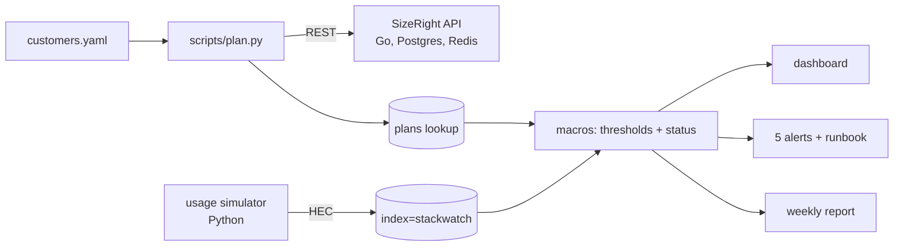

# StackWatch

A Splunk app that checks whether each customer's Splunk stack was **sized right**. It compares the capacity
planned by [SizeRight](https://github.com/Likithaa07/sizeright) with real usage, flags customers as
**UNDERSIZED / OK / OVERSIZED / NO DATA**, alerts on-call with a runbook link, and writes a weekly
plan-accuracy report.

## Why

SizeRight sizes a customer's Splunk stack up front. But customers grow, shrink and change how they search, so
a plan that was right on day one can be wrong a month later. StackWatch closes that loop: it keeps checking
every plan against real usage and tells on-call, and the customer, when a stack needs re-sizing.

## Features

- **Plan vs actual** for every customer, using SizeRight's own capacity model
- **Four statuses** with sustained-time rules, so a single spike never pages anyone
- **Dashboard** with region and customer filters, drilldown and a rules-version check (loads in < 1 s)
- **5 alerts** (UNDERSIZED, NO DATA, stale plans, plan data quality, rules mismatch), throttled per customer, each linked to a runbook section
- **Weekly report** in one command: customers ranked worst first, each with an action
- **Kubernetes**: SizeRight, Postgres, Redis and the simulator via one Helm chart

## Architecture

## Results (measured, with evidence in `docs/evidence/`)

| What | Result | Target |
|---|---|---|
| Data delivery | 1,420 events sent, 1,420 received (0 loss) | no loss |
| Alert detection (NO DATA) | 12.1 min | 20 min |
| Dashboard load | 0.65 s status, 0.58 s chart | 5 s |
| Failure drills | 4 run; wrong plan caught in 1 s on the dashboard, 3 min by alert; fixed in 5 s | detect + fix |
| Gaps found by drills | 3, all fixed with tests (#36, #37, #38) | n/a |
| Kubernetes | SizeRight, Postgres, Redis, simulator up in 22 s with one command | one command |
| Quality gates | 56 tests, 93% coverage; CI runs ruff, pytest, helm lint, gitleaks | 85% coverage |

## Design decisions

| Decision | Why | Trade-off |
|---|---|---|
| Alerts need 15 min sustained above 90% | peaks are normal; paging on spikes burns out on-call | slower than instant; measured 12.1 min, inside the 20 min target |
| Report uses p95, not the alert rule | planning should see busy hours an incident rule ignores | a stack can be OK on the dashboard but flagged in the report (explained in both) |
| All thresholds in one macro, tested in CI | one place to tune; tests fail if a number drifts or is hardcoded | thresholds need a PR to change, by design |
| Plans written atomically (temp file, then rename) | a failed SizeRight call must never leave half a lookup | none in practice; drill D3 proved it |
| Retry only network errors and 5xx | broken JSON or a 4xx will not fix itself | found by a drill, fixed in #36 |
| Unknown plan age counts as stale | safer to re-plan than to trust a plan of unknown age | demo plans alert until re-planned |
| Descoped the recorded session via a change request | keep scope changes visible, not silent | written walkthrough instead of video (#46) |

## Quick start

    python -m venv .venv && source .venv/bin/activate && pip install requests pyyaml
    cp .env.example .env                  # set HEC_TOKEN (see docs/splunk-setup.md)
    python -m scripts.plan                # size every customer with SizeRight (needs SIZERIGHT_TOKEN)
    python scripts/package.py             # build dist/stackwatch.tgz, then install it in Splunk
    set -a; source .env; set +a; python -m simulator
    SPLUNK_PASSWORD=... python -m scripts.report   # weekly report into docs/reports/ (SPLUNK_MGMT_URL defaults to https://localhost:8089)

Or run SizeRight, Postgres, Redis and the simulator on Kubernetes: `./scripts/k8s-up.sh` ([docs](docs/kubernetes.md)).

## Repo map

| Path | What |
|---|---|
| `simulator/` | usage generator, HEC client with retries, runner with heartbeat |
| `scripts/plan.py` | calls SizeRight, writes the plans lookup atomically |
| `scripts/report.py` | weekly plan-accuracy report from the Splunk REST API |
| `splunk_app/stackwatch/` | the app: macros, dashboard, 5 alerts, plans lookup |
| `deploy/helm/stackwatch/` | Helm chart with probes, limits and Kubernetes Secrets |
| `docs/` | design, requirements, setup, runbook, drills, customer explainer, status report |

## How it was built

Run like a client project: signed-off [requirements](docs/requirements.md), 23 tickets over 5 sprints (16 planned, 6 found by reviews and drills, 1 change request) on a
GitHub Project board, one ticket = one branch = one PR, a Definition of Done, and live evidence in every PR.
Failure [drills](docs/drills.md) found three gaps, each fixed with a test. Start with the
[customer explainer](docs/customer-explainer.md) and the [final status report](docs/status-report.md).
