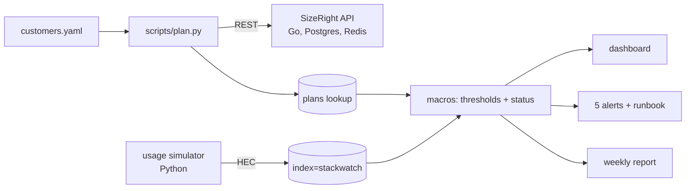

# StackWatch

A Splunk app that checks whether each customer's Splunk stack was **sized right**. It compares the capacity
planned by [SizeRight](https://github.com/Likithaa07/sizeright) with real usage, flags customers as
**UNDERSIZED / OK / OVERSIZED / NO DATA**, alerts on-call with a runbook link, and writes a weekly
plan-accuracy report.

## Architecture

## Results (measured, with evidence in `docs/evidence/`)

| What | Result | Target |
|---|---|---|
| Data delivery | 1,420 events sent, 1,420 received (0 loss) | no loss |
| Alert detection (NO DATA) | 12.1 min | 20 min |
| Dashboard load | 0.65 s status, 0.58 s chart | 5 s |
| Failure drills | 4 run; wrong plan caught in 1 s on the dashboard, 3 min by alert; fixed in 5 s | detect + fix |
| Gaps found by drills | 3, all fixed with tests (#36, #37, #38) | n/a |
| Kubernetes | SizeRight, Postgres, Redis, simulator up in 22 s with one command | one command |
| Quality gates | 56 tests, 93% coverage; CI runs ruff, pytest, helm lint, gitleaks | 85% coverage |

## Quick start

    python -m venv .venv && source .venv/bin/activate && pip install requests pyyaml
    cp .env.example .env                  # set HEC_TOKEN (see docs/splunk-setup.md)
    python -m scripts.plan                # size every customer with SizeRight (needs SIZERIGHT_TOKEN)
    python scripts/package.py             # build dist/stackwatch.tgz, then install it in Splunk
    set -a; source .env; set +a; python -m simulator
    python -m scripts.report              # weekly report into docs/reports/

Or run SizeRight, Postgres, Redis and the simulator on Kubernetes: `./scripts/k8s-up.sh` ([docs](docs/kubernetes.md)).

## Repo map

| Path | What |
|---|---|
| `simulator/` | usage generator, HEC client with retries, runner with heartbeat |
| `scripts/plan.py` | calls SizeRight, writes the plans lookup atomically |
| `scripts/report.py` | weekly plan-accuracy report from the Splunk REST API |
| `splunk_app/stackwatch/` | the app: macros, dashboard, 5 alerts, plans lookup |
| `deploy/helm/stackwatch/` | Helm chart with probes, limits and Kubernetes Secrets |
| `docs/` | design, requirements, setup, runbook, drills, customer explainer, status report |

## How it was built

Run like a client project: signed-off [requirements](docs/requirements.md), 22 tickets over 5 sprints on a
GitHub Project board, one ticket = one branch = one PR, a Definition of Done, and live evidence in every PR.
Failure [drills](docs/drills.md) found three gaps, each fixed with a test. Start with the
[customer explainer](docs/customer-explainer.md) and the [final status report](docs/status-report.md).
